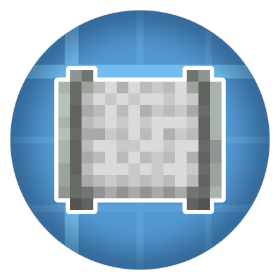
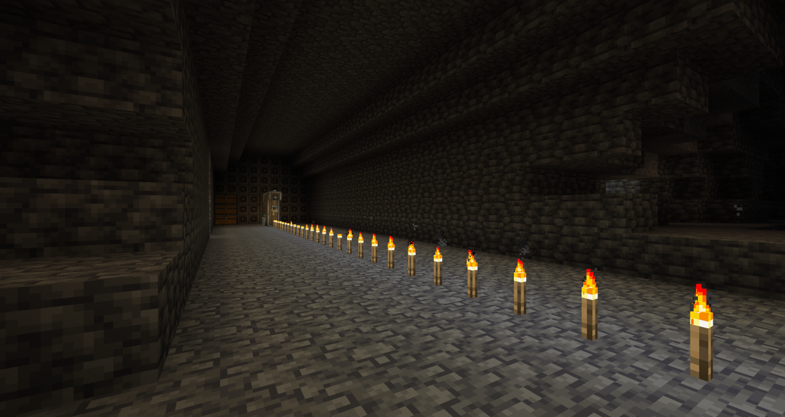
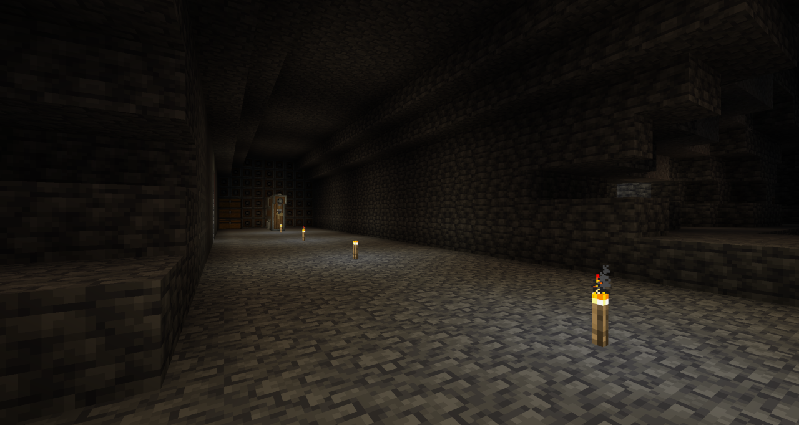
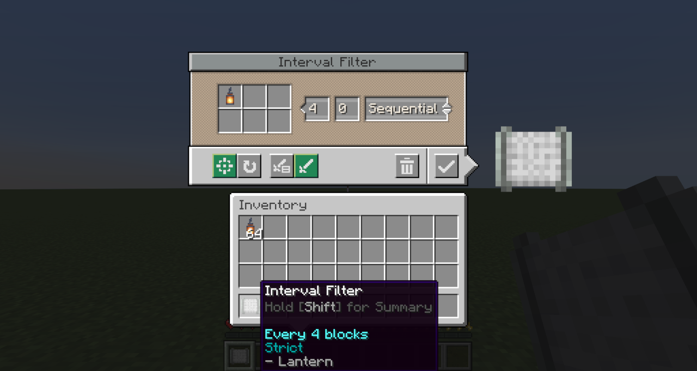
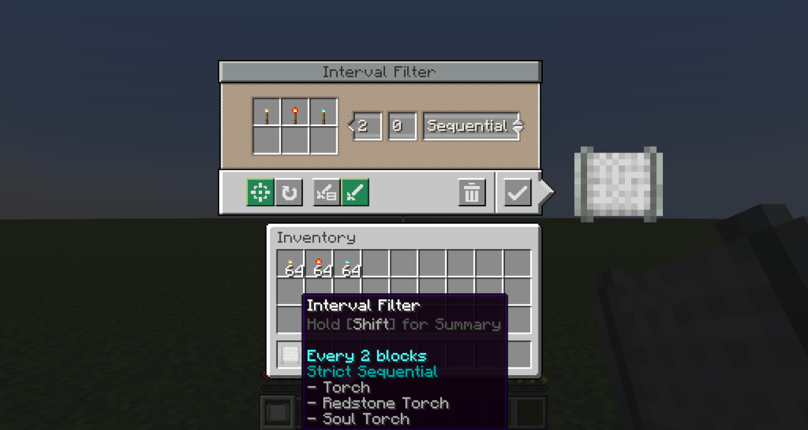
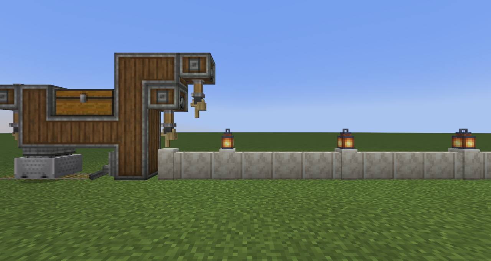
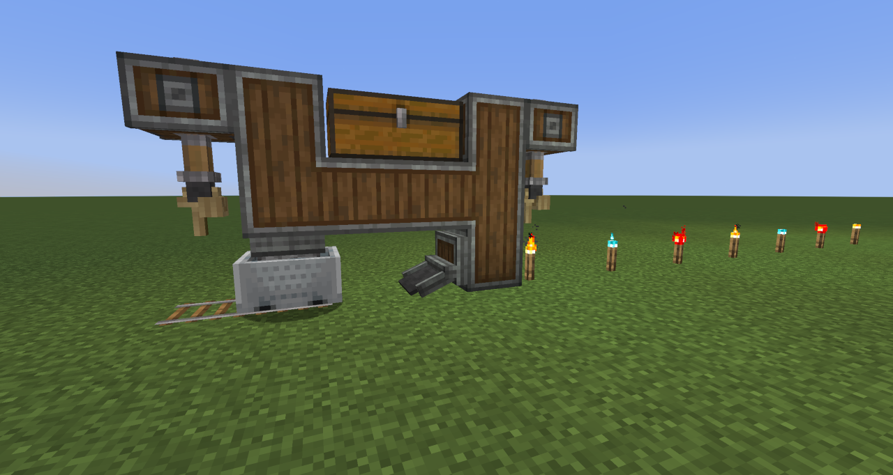
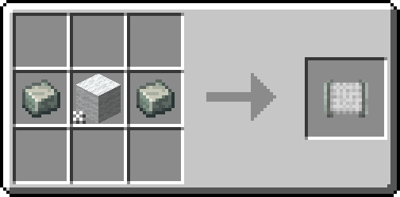
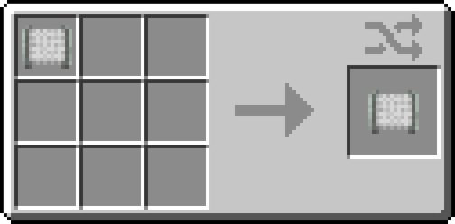

# Create: Interval Filter

A small addon for [Create](https://modrinth.com/mod/create) that adds the **Interval Filter** — a filter item that configures a Deployer to
activate at set distance intervals as a contraption moves.

  

  <!-- a href="https://modrinth.com/mod/create-interval-filter"></a -->
  <!-- a href="https://www.curseforge.com/minecraft/mc-mods/create-interval-filter"></a-->
  
  
  
  

---

## What does it do?

Building automated contraptions in Create often requires placing items at precise, repeating intervals — something
vanilla Deployers can't do on their own. The Interval Filter solves this.
Place it in a Deployer's filter slot and it controls the cadence of activations: place items every 3rd block, every
10th block, or any interval up to 64 — with an optional offset to phase-shift where the pattern starts.

This opens up builds that were previously tedious or impossible to tune, such as:

- Evenly-spaced torch placement behind a mining drill
- Repeating decoration patterns on a wall or floor
- Skipping the first few blocks before a pattern begins
- Alternating between different items placed in sequence or at random

<table style="text-align:center;">
  <tr>
    <td><b>Before</b></td>
    <td><b>After</b></td>
</tr>         
  <tr>
    <td></td>                                                                                                                                                           
    <td></td>
  </tr>                                                                                                                                                                                                                                                                                                          
</table>  

---

## Features

- **Block Interval** — Controls how many blocks the contraption travels between each Deployer activation. Supports
  values from 1 to 64.

- **Initial Offset** — Delays the start of the pattern by a set number of blocks. Useful for lining up placements
  without needing to redesign or reposition contraptions.

- **Execution Modes** — Two modes control what happens when a placement fails at the intended position:
    - **Strict** — Skips the activation and continues the pattern unchanged. Use this when exact positioning matters.
    - **Best Effort** — Keeps retrying on subsequent blocks until a placement succeeds. Use this when gaps are
      unacceptable.

- **Placement Mode** — Two modes control what happens when multiple items (up to 6) are configured:
    - **Sequential** — Cycles through all items in order each time the Deployer activates
    - **Random** — Selects one item at random for each activation.

<table style="text-align:center;">
  <tr>
    <td><b>Single Item</b></td>
    <td><b>Multiple Items</b></td>
  </tr>
  <tr>
    <td></td>                                                                                                                                                           
    <td></td>
  </tr>                                                                                                                                                                                                                                                                                                          
  <tr>
    <td></td>                                                                                                                                                           
    <td></td>
  </tr>                                                                                                                                                                                                                                                                                                          
</table>  

---

## Crafting

Craft any wool block with 2× andesite alloy to create the Interval Filter.

Crafting a configured Interval Filter resets all stored settings back to defaults.

---

## Usage

1. Craft the Interval Filter.
2. Right-click it to open the configuration screen.
3. Set the desired Block Interval and optionally an Initial Offset.
4. Add up to 6 items to the filter slots. Choose Strict or Best Effort mode depending on whether missed placements
   should be skipped or retried...and choose Sequential or Random if using multiple items.
5. Place the configured Interval Filter into the filter slot of a Deployer on your contraption.

> **Note:** The Interval Filter only works in a Deployer's filter slot on moving contraptions. It cannot be used in
> other filter slots.

---

## Notes

- **Train Relocation** — Using a Wrench to pick up and relocate a train resets the interval counter, offset, and
  sequence order. Regular stops (such as stations) do not reset progress.
- **Teleporting** — Teleporting or relocating a contraption restarts the pattern rather than counting as distance
  traveled. Trains keep their pattern through portals.
- **Reversing** — Nothing is placed while a contraption travels in reverse, but the pattern is remembered and
  continues unbroken when it moves forward again. Forward is the front of a train, or the first direction other
  contraptions move.
- The filter can be reconfigured at any time by right-clicking it in your hand. Placing it back into the Deployer
  applies the updated settings immediately.

---

## FAQ

**Does the Interval Filter work on non-train contraptions?**
Yes — it works on any moving contraption that includes a Deployer, such as those driven by a Minecraft w/Furnace,
Mechanical Bearing or Contraption Controller.

**What happens if the Deployer's item supply runs out mid-pattern?**
The Deployer behaves as normal — it simply won't activate until items are available again. The interval counter
continues to advance.

**Can I use multiple Interval Filters on the same contraption?**
Yes. Each Deployer tracks its own interval state independently.
